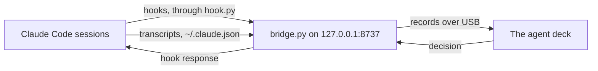

# Agent deck bridge — design

How the bridge works and why: what it reads from Claude Code, the records it makes, how it holds a permission request
or a question for the deck, how the plugin and `install.py` set it up, and what is still open. For whoever changes the bridge; how
to install and use it is the [README](README.md).

**Source of truth.** The code in this folder, and this doc for the reasons. Claude Code's behaviour comes from its
documentation at code.claude.com `[CC]` and from real sessions recorded through the bridge `[R]`; where this doc and
Claude Code's documentation disagree, the documentation wins. The deck's side — its screens, the records it takes
and the link on the USB cable — is the firmware repo's
[docs/ONX2424G013_AGENT_DECK.md](https://github.com/alxv2016/nextion-agent-deck/blob/main/docs/ONX2424G013_AGENT_DECK.md): the records are its §6, the link its §16, and how Claude Code reaches the deck
its §3.

**Stability.** The code cites this doc as `DESIGN.md §n`. Do not renumber; add new material under the next free
number.

| Tag | Meaning |
| --- | --- |
| `[CC]` | From Claude Code's documentation (code.claude.com/docs: hooks, status line, plugins, settings, sub-agents), read 2026-10-28 and 2026-10-29 |
| `[R]` | Seen in a real Claude Code session recorded through the bridge, with the date; Claude Code 2.1.195 on macOS unless stated |
| `[?]` | Unverified; tracked in §8 |

| § | Section | Look here for |
| --- | --- | --- |
| 1 | [What it is](#1-what-it-is) | The bridge between Claude Code and the deck, in a picture |
| 2 | [Files](#2-files) | What each script does |
| 3 | [From Claude Code to the deck](#3-from-claude-code-to-the-deck) | Which hook or status line makes which record |
| 4 | [Permission requests](#4-permission-requests) | Holding a request for the deck, the stand-in, VS Code sessions, text on the glass, recordings |
| 5 | [Setting it up](#5-setting-it-up) | The plugin, `install.py`, using one or the other, the bridge stopping itself |
| 6 | [Decisions](#6-decisions) | Why command hooks, why a detached bridge |
| 7 | [Windows](#7-windows) | What runs there, what does not, the work |
| 8 | [Open items](#8-open-items) | What is not yet known or built |

---

## 1. What it is

The bridge runs on the Mac beside Claude Code and turns its hooks and status lines into the deck's records, sent
over the USB-C cable; the deck sends back the developer's answer to a permission request or a question, which the bridge gives
Claude Code as the hook's response. Python 3.9 or later, the standard library only.

---

## 2. Files

| File | Does |
| --- | --- |
| `hook.py` | What Claude Code runs for every hook (`hook.py hook`), the `statusLine` (`hook.py status`) and the `subagentStatusLine` (`hook.py subagent-status`): POSTs the input to the bridge on `127.0.0.1:8737` (`DECK_BRIDGE_PORT` in Claude Code's environment), prints the bridge's answer, or the status line — `deck \| Opus \| ctx 8% \| 5h 23% \| 7d 41%`, `deck off` while the bridge is stopped. With the bridge stopped a hook prints nothing and exits 0. It waits for the bridge 2 s (`TIMEOUT_S`) inside each hook's 5 s `timeout` (`install.py`'s `HOOK_TIMEOUT_S`), and 590 s on a permission request, which the bridge may hold for the device. From the plugin, `hook.py hook --plugin`: it starts the bridge when none answers (§5) |
| `bridge.py` | The server, on `127.0.0.1` only, one at a time — a second finds the port taken and goes before it touches the deck: each input through the state machine, each record a JSON line on stdout; `--record FILE` keeps every input with its arrival time, the transcripts' included; `--port`, else `DECK_BRIDGE_PORT`, else 8737 — the same port `hook.py` posts to; `--context-window N`, the window a VS Code session's context share is taken of until a terminal session's status line has given its model's |
| `state.py` | The state machine (`Deck`): pure, the clock passed in, so a recording replays into the same records |
| `transcripts.py` | After each hook but `SessionEnd`, the session's transcript — its `isSidechain` lines skipped — and, for a hook with `agent_id` and `agent_type`, the sub-agent's (`agent_transcript_path`, else `<session_id>/subagents/agent-<agent_id>.jsonl` beside it) read on from where the last read stopped: the newest response's context, model and output tokens (`response_tokens`) and its `effort`, a response's lines carrying its final count, a new `ai-title`, and a sub-agent's `description` from its `.meta.json`, once; each as a `transcript` input |
| `usage_cache.py` | Once a second, `~/.claude.json` parsed again if it changed, and only its `cachedUsageUtilization` kept: a new fetch's two windows as a `usage-cache` input in the status line's shape. `bridge.py --no-usage-cache` leaves the file unread |
| `usage_refresh.py` | While the deck is attached, `claude -p /usage --settings '{"disableAllHooks": true}' --no-session-persistence` as the deck connects and then hourly (`--refresh-usage`, 3600 s; 0 never) — the developer's choice, 2026-10-29: the shares move slowly, and each reset counts down from its moment between fetches — so the cache holds a fresh fetch: it fires no hooks — so no page of its own on the deck — keeps no session, and asks the model nothing. `--bare` would skip the login `/usage` needs `[R]` 2026-10-29 |
| `install.py` | Sets the bridge up: the hooks and both status lines in `~/.claude/settings.json`, backed up first, and on macOS, only when the developer says yes to its question — no the default, and the answer with no terminal to ask in — a login agent that runs `bridge.py --quiet` now and at every login and again if it stops, its log `~/Library/Logs/agent-deck-bridge.log`: the developer's choice, 2026-10-29, as starting at login unasked is invasive; `--login` and `--no-login` answer it, and no removes a login agent set up before; `--status` what is set up and whether the deck is attached (`GET /health`), `--uninstall` both out, `--dry-run`. It knows its own entries by their `hook.py` command wherever the folder lives, and stops at a status line that is not the bridge's; while its hooks are in, the plugin's stand aside (§5). The developer runs it — an agent's sandbox may not write `~/.claude` or `~/Library` |
| `replay.py`, `scrub.py` | Play a recording into records, or check them against a file — `--context-window N` as the bridge was run; clean a recording for the repo — ids, paths and free text replaced, the shape and timing kept |
| `test_bridge.py`, `fixtures/` | Every `<name>.inputs.jsonl` replayed into its `<name>.records.jsonl`, the rules one by one, the installer, `hook.py` through a running bridge, the plugin's state and its manifests |
| `plugin_state.py` | Whether the plugin is installed and switched on, from Claude Code's own files: `~/.claude/plugins/installed_plugins.json` and the `enabledPlugins` of each install's scope (§5) |
| `.claude-plugin/plugin.json`, `.claude-plugin/marketplace.json`, `hooks/hooks.json` | The plugin and the marketplace that lists it, both this folder (`"source": "./"`); every event of §3 running `hook.py hook --plugin` (§5) |

---

## 3. From Claude Code to the deck

| Input `[CC]` | Records |
| --- | --- |
| Any hook or status line from a session not yet seen | A session page, `done`, or `idle` and `active` false while another chat is active, named `Claude Code` until Claude Code titles the session: a hook's `session_title`, the status line's `session_name`, or the transcript's `ai-title`, the latest of them — the developer's choice, 2026-10-29, so two sessions in one folder read apart. A subagent status line or a `SessionEnd` from a session not yet seen makes none |
| `UserPromptSubmit` | Requests still open on its sub-agents closed, `answered_elsewhere`, and those sub-agents back to `working` — a deny in the terminal fires no hook; one with feedback arrives as this prompt, and the sub-agent works on until its own `SubagentStop` `[R]` 2026-10-29; the session's own open requests closed too, and the session `working`, detail `Thinking`, and its sub-agents that finished removed, one still running staying: the developer's choice, 2026-10-29, so the pages are the work in hand. The session is now the active chat, the closest there is to the one on view: no hook is known to fire as VS Code changes chat (§8). Every other agent gets `active` false, grey on the deck, the developer's choice, 2026-10-30; another session that was `done` goes `idle`, and its finished sub-agents are removed. What still runs keeps its state and page, and a request it makes opens on the deck |
| `PreToolUse` | The agent's own open requests closed, `answered_elsewhere`; `working`, detail the tool and what it touches: `Bash: npm test`, `Edit: deck.cpp`, `WebFetch: example.com` |
| `PreToolUse` for `AskUserQuestion`, the deck taking questions | As any `PreToolUse`, then `needs_you` and a question record, one part of the call at a time (§4). A question the deck cannot hold, over four options or with none, is left to the terminal |
| `PermissionRequest` for `AskUserQuestion` (`TERMINAL_ONLY`) | `needs_you`, detail `Question: …` — no request: allowing it only lets the question be asked, and its answer is the option the developer picks; seen on the board, the question still waiting in VS Code after the deck's Allow `[R]` 2026-10-29. So it reaches the deck at `PreToolUse`, and this hook means the terminal is asking |
| `PermissionRequest` | On the agent that asked — from inside a sub-agent it carries `agent_id` `[R]` 2026-10-29 — `needs_you`, then a request: the whole command and its description, the path and diff or new content, the URL and prompt, or else the input's fields one a line; over 2048 B of UTF-8 cut on a character and marked `cut` |
| `PostToolUse`, `PostToolUseFailure`, `PermissionDenied` | The agent's open request for that tool closed, `answered_elsewhere`; `working`. An allow in the terminal shows as the tool's `PostToolUse` `[R]` 2026-10-29, or `PostToolUseFailure` when it fails, each only once the tool has finished `[CC]` |
| `Notification` (`permission_prompt`, `elicitation_dialog`, `elicitation_url_dialog`, `agent_needs_input`) | The session `needs_you`, unless a request from it or its sub-agents is open: the notice carries no `agent_id` `[R]` 2026-10-29 |
| `Stop`, `SubagentStop` | `done`; open requests closed; a detail of `Thinking` cleared. In a previous chat, a session `idle` and a sub-agent removed. A session stops while a sub-agent it started works on, its `Agent` tool call already answered `[R]` 2026-10-29 |
| `SubagentStart`; a hook with `agent_id` | A sub-agent page under its session, `working`, named after `agent_type` until its transcript gives a description. A hook from an `agent_id` never started and with no `agent_type` makes none: Claude Code runs such an agent for itself about a second after each `Stop`, and it sends only its `SubagentStop` `[R]` 2026-10-29 |
| `SessionEnd` | Its sub-agents removed, then the session; the active chat's leaves none active until a chat is prompted or opened |
| Once a second | A previous chat working with no hook for `STALE_S`, 600 s, `idle`, or removed for a sub-agent: an interrupt sends no `Stop`, and a previous chat has no next prompt to clear it |
| The deck's `hello` | `version` 3 takes the state `idle` and `active`; an older deck gets `done` and no `active` (`shows_idle`): it would read `idle` as `Working` and never make room for another agent |
| Status line | The session's `context_pct`, and the window for its model; usage, sent again as a reset's minutes change, and a window past its `resets_at` unknown — its share was the old window's, as Claude Code drops it then `[CC]` |
| Usage cache `[R]` 2026-10-29 | Usage, when its fetch is newer than the last status line's arrival — the newer of the two always wins |
| Subagent status line | Nothing: the VS Code extension runs none, and the transcript gives every session and sub-agent the same figure |
| Transcript `[R]` 2026-10-30 | An agent's `tokens`, as Claude Code's agent map counts them: a session's context, a sub-agent's context with its last response's output, 85,457 + 3,287 for a map's `88.7k tokens`. A response's line carries its final count, written as it ends, and the bridge reads on at each hook, so the figure follows by a tool call. An agent's `model`, shown while it is not working or has no tokens yet: its model as Claude Code names it, `Opus 5.5` from `claude-opus-5-5`, the older and cloud providers' spellings read too and an id it does not recognise sent as it came, and its effort, `Opus 5.5 • high`, from a hook's `effort.level` `[CC]` or the transcript line's `effort`; a sub-agent's page named after its `description`, as Claude Code's agent map titles it; a session named after its `ai-title`; a session's `context_pct` while no status line has given one, its window from a status line for its model, `--context-window`, or `KNOWN_WINDOWS` (`claude-opus-5-5` 1M, from the developer's session at 664k tokens with 31 % left before auto-compact) |

---

## 4. Permission requests

- **A request is held for the deck's answer with `--hold SECONDS`** (570 by default, under 580): its hook's HTTP
  request waits for the answer — `allow`, or `deny` with the message `Denied on the agent deck.` — up to the
  hold, then goes back with no decision and the request closes `timed_out`. A request answered in the terminal
  lets its hook go at once with none, so a late answer from the deck reaches nothing. `hook.py` waits 590 s on a
  permission request (`REQUEST_TIMEOUT_S`) inside its hook's 600 s `timeout` (`install.py`, `hooks/hooks.json`). With no deck attached
  and no `--answer`, every request goes back at once with no decision ([AGENT_DECK §16](https://github.com/alxv2016/nextion-agent-deck/blob/main/docs/ONX2424G013_AGENT_DECK.md#16-link)).
- **No hook says the terminal answered** `[CC]`: an allow shows only when its tool ends, and a manual deny fires
  nothing, `PermissionDenied` being auto mode's and `Stop` not running on an interrupt. So the bridge looks in two more
  places while a request is open. Each second it reads on in the transcript for a `tool_result` of the call it holds,
  by the `tool_use_id` of its `PreToolUse`, which a refused call should have at once `[?]` (§8); the format is
  undocumented, as transcripts are. Every 250 ms (`GONE_POLL_S`) it looks at the hook's connection, which closes if
  Claude Code stops the hook; whether it does is undocumented (§8). Either closes the request `answered_elsewhere`.
  An allow whose tool runs for minutes, if Claude Code leaves the hook running, still shows until the tool ends.
- **A question is held at `PreToolUse`, not at `PermissionRequest`.** Only there can a hook answer it: `allow` with
  `updatedInput` holding the input's `questions` and an `answers` map runs the tool without prompting, and `allow`
  alone is not enough `[CC]`. `answers` is keyed by each question's text, its value the option's `label`, several
  joined with `, ` `[CC]`. The same at `PermissionRequest` is undocumented and not tried.
- **Nothing shows in the terminal while a question is held**, as the prompt comes after `PreToolUse`, so there is no
  answering in both places as a request has. A call is held `--question-hold` seconds (120 by default, under 580), all
  its parts together: long enough to reach the knob, short enough that a developer at the keyboard is not left waiting. Then it closes
  `timed_out` and the terminal asks. The hook's `timeout` is 600 s for every `PreToolUse`, a ceiling: `hook.py`'s own
  2 s still bounds every other tool.
- **The deck says it takes questions**: `hello` with `version` 2 or later turns them on (`asks_questions`), and losing
  the deck turns them off. A deck on older firmware never gets a record it would drop while its hook waits; it keeps
  `needs_you` and the terminal.
- **One record to a part.** The link drops JSON nested past two levels, and a call holds up to four questions of
  objects, so each goes as a flat `question` record, the next once the last is answered, under one `id` with its
  `part`. The deck answers `{"id", "part", "chosen"}`, bit n for option n, and the `ack` gives the `part` back; a
  resend of an earlier part changes nothing. `chosen` 0 leaves the whole call to the terminal: KEY held on the question, or the deck's queue full.
- **An option's card is `label: description`**, 96 characters, the glass stopping it at four lines; what goes back
  is always the `label`. "Other" and free text are the terminal's.
- **`--answer allow|deny SECONDS` stands in for the device**, answering each held request so long after it
  opens — the answers tried with no deck attached. It leaves questions alone: their answer is the developer's.
- **A session in the VS Code extension runs no status line.** It runs neither the status line nor the subagent status line `[R]`
  2026-10-29: its hooks give the pages, states, details and requests, Claude Code's usage cache the usage, which the extension does not write but the bridge's `claude -p /usage` does as the deck
  connects and hourly after, and a terminal session's status line brings with every response — its
  transcripts each agent's tokens, the session's title and sub-agent names, and its context share once its model's window is known — from a
  terminal session's status line for that model, `--context-window`, or `KNOWN_WINDOWS`; the transcript names the model without the window (`claude-opus-4-8`, where the
  status line says `claude-opus-4-8[1m]`) `[R]` 2026-10-29. `claude -p "/usage"` prints nothing `[R]` 2026-10-29;
  the plan's limits reach the bridge from a status line or the usage cache only.
- **Text reaches the records as the glass draws it** — ASCII, `°` and `•`, every other character `?`; names
  40, details 64, a model and effort 24 and tools 48 characters, cut with `...`.
- **An agent record goes out only when something but `since_s` changed** — the device counts `since_s` up
  itself ([AGENT_DECK §6](https://github.com/alxv2016/nextion-agent-deck/blob/main/docs/ONX2424G013_AGENT_DECK.md#6-data-the-screens-take)).
- **A recording holds prompts, commands and file contents.** It stays in `$TMPDIR`, outside the repo; only its
  `scrub.py` output, read first, goes in `fixtures/`, beside the records `replay.py` makes of it.

---

## 5. Setting it up

Two ways, one or the other: the Claude Code plugin, which carries the hooks and starts the bridge itself, or
`install.py`, which writes the hooks into the developer's settings and may start the bridge at login. Both run the
same `hook.py` and `bridge.py`.

| | The plugin (`alxvlabs-agent-deck`) | `install.py` |
| --- | --- | --- |
| Installed with | `/plugin marketplace add alxv2016/alxvlabs-agent-bridge`, then `/plugin install alxvlabs-agent-deck@alxvlabs` | `python3 install.py` in a copy of this folder |
| The hooks | `hooks/hooks.json`, run from `${CLAUDE_PLUGIN_ROOT}`, merged with the developer's own `[CC]` | Written into `~/.claude/settings.json`, backed up first |
| The bridge | Started detached by the first hook that finds none answering, and running on across sessions | Run by hand, or by the login agent if the developer says yes |
| The status line | None — a plugin cannot set one: only `agent` and `subagentStatusLine` take effect from a plugin's settings `[CC]`. Nothing depends on it: the usage refresh and the transcripts give what it gave | `deck \| …` or `deck off` |
| Stopped by | Disabling or uninstalling the plugin: the bridge sees it and goes | `install.py --uninstall`, or Ctrl-C |
| Updates | `/plugin update`, when `version` in `.claude-plugin/plugin.json` changes; auto-update is off for a marketplace that is not official unless turned on `[CC]` | A new copy of the folder, then `install.py` again |

- **The plugin's hooks stand aside while `install.py`'s are in the user settings**, so no event reaches the bridge
  twice: `hook.py hook --plugin` exits at once when it finds `install.py`'s `hook.py` commands there. `install.py`
  and `install.py --status` say when the plugin is installed too.
- **A hook from the plugin starts the bridge when none answers** — any hook, not only `SessionStart`, since a plugin
  installed mid-session runs its hooks in that session `[R]` 2026-10-29. It starts `bridge.py --quiet --plugin
  alxvlabs-agent-deck` in its own session with no terminal, its log `~/Library/Logs/agent-deck-bridge.log`
  (`~/.local/state/` off macOS), then waits up to 2 s (`START_WAIT_S`) for it to listen and gives it the input
  that started it. Two hooks starting one each at once is harmless: the second bridge finds the port taken and goes.
- **Claude Code stops nothing the plugin started** `[R]` 2026-10-29: a probe plugin's `SessionStart` hook started one
  detached Python process, which ran on after `/exit`, after `claude plugin disable` and after `claude plugin
  uninstall`. So the bridge stops itself: every 10 s (`PLUGIN_CHECK_S`) it asks `plugin_state.py`, and goes once the
  plugin it has seen installed is uninstalled or disabled, or its own folder is gone.
- **An update replaces a running bridge.** Claude Code keeps the old version's folder, marked `.orphaned_at`, beside
  the new one `[R]` 2026-10-30, so a folder still there says nothing: the bridge goes once `installed_plugins.json`
  no longer lists its folder, having listed it, or its folder carries the mark. It waits for any request it holds, so
  no answer is cut off, and the next hook starts the new code. A hook starts the listed version's `bridge.py`, not
  its own folder's, as a session opened before the update still runs the old `hook.py`. A folder never listed and
  never marked is `claude --plugin-dir`'s, and stays. Versions before 0.2.1 do none of this, so leaving one takes a
  manual `kill`, as the README says.
- **Disabled means every install's settings say false.** An install's scope picks its settings file — `user`
  `~/.claude/settings.json`, `project` the project's `.claude/settings.json`, `local` its
  `.claude/settings.local.json` — and the plugin is off only when every install's file has
  `enabledPlugins["alxvlabs-agent-deck@<marketplace>"]` false. A file missing, caught mid-write or holding no switch
  counts as on: a wrong stop loses the deck, a late one only leaves the bridge idle.
- **A bridge run from a folder Claude Code was pointed at** (`claude --plugin-dir`) is never listed as installed,
  so it is never seen uninstalled and runs until stopped by hand.
- **Nothing is kept in the plugin's data folder** (`${CLAUDE_PLUGIN_DATA}`): an uninstall deletes it `[R]`
  2026-10-29, under a bridge that may still be running.
- **The plugin and the marketplace are this one folder**: `.claude-plugin/marketplace.json` lists the plugin with
  `"source": "./"`, so the repo root is both. A plugin's name may not start with `claude-` `[CC]`; the marketplace is
  `alxvlabs`.

---

## 6. Decisions

| Decision | Why | Alternatives that don't work, and why |
| --- | --- | --- |
| Every hook a command hook through `hook.py` | With the bridge stopped, Claude Code runs as without it: no notice, its own prompt (§4) — the developer's choice, 2026-10-29 | `type: "http"` hooks — a `hook error` notice on every event while the bridge is stopped `[CC]`, and `SessionStart` and the status line take only commands `[CC]` |
| From the plugin, a detached bridge that stops itself | One process holds the deck's port across every session, started with no setup step | An MCP server or a monitor — each runs per session and stops with it `[CC]`; a login agent — no plugin component starts one |
| Starting at login asked, no the default (`install.py`) | Starting a background process at every login unasked is invasive — the developer's choice, 2026-10-29 | Always on — a process the developer never chose; never — the deck goes blank after every restart |

---

## 7. Windows

Claude Code and the deck both work on Windows — the deck appears as a COM port through Windows' own USB serial
driver — but the bridge does not yet. Until it does, the plugin's hooks never start the bridge on Windows
(`hook.py`'s `can_start()`): a bridge that fails as it starts would make every hook wait its 2 s for it.

| Part | On Windows |
| --- | --- |
| `hook.py`, `state.py`, `transcripts.py`, `usage_cache.py`, `usage_refresh.py`, `plugin_state.py` | Expected to run as they are: the standard library's networking, `~` as `%USERPROFILE%`, `claude` found on `PATH` |
| `serial_link.py` | Does not: it uses `termios` and `fcntl`, Unix only, and looks for `/dev/cu.usbmodem*` and `/dev/ttyACM*`; `bridge.py` imports it, so the bridge does not start |
| The hooks | Quoted for a Unix shell, and `python3`; Claude Code on Windows runs a command hook through Git Bash when installed, else PowerShell, and an exec-form hook (`command` with `args`) needs a real `.exe`, such as `python.exe` `[CC]` |
| `install.py`, starting at login | macOS only; the Windows counterpart is a Task Scheduler task at log on running `pythonw.exe`, which opens no console window — behind the same question |

- **The work:** a Windows back end for `serial_link.py` — the standard library's `ctypes` over Windows' serial API,
  keeping "nothing to install", or the `pyserial` package at the cost of one install step — opening the COM port with
  DTR and RTS held low so the deck does not reset (the firmware's FIRMWARE_CONFIG §8); finding the deck's COM port,
  or `--serial COM5`; the hooks in exec form; the login task.
- **What it needs:** a Windows PC with the deck attached to test on — the serial behaviour cannot be checked from
  macOS.

---

## 8. Open items

| Item | Status | Unblocked by |
| --- | --- | --- |
| Which chat is on view: that no hook fires as VS Code changes chat, and when `SessionEnd` fires for a chat left open, neither of which Claude Code documents. The active chat is the one last prompted until then | Open `[?]` | A real session logging its hooks through a change of chat, a new chat and a closed tab |
| The bridge on Windows (§7): the deck as a COM port, the hooks through Git Bash or PowerShell, the login task | Open `[?]` | The Windows serial back end, run on a Windows PC with the deck attached |
| A request answered in the terminal, in a real session: that a deny's `tool_result` reaches the transcript at once, and whether Claude Code stops the held hook, which decides how fast an allow leaves the deck | Open `[?]` | One allow and one deny in the terminal, with a long-running tool |
| A question answered on the deck in a real session: Claude Code taking `answers` from a `PreToolUse` hook with a multi-select's labels joined, and what a developer pressing Esc during the hold leaves behind | Open `[?]` | One real `AskUserQuestion` with the deck attached |
| The plugin end to end: installed from the GitHub marketplace, the bridge started by a hook, stopped by a disable and by an uninstall | Open `[?]` | One install from `alxv2016/alxvlabs-agent-bridge` with the deck attached |
