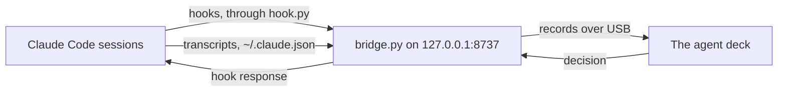
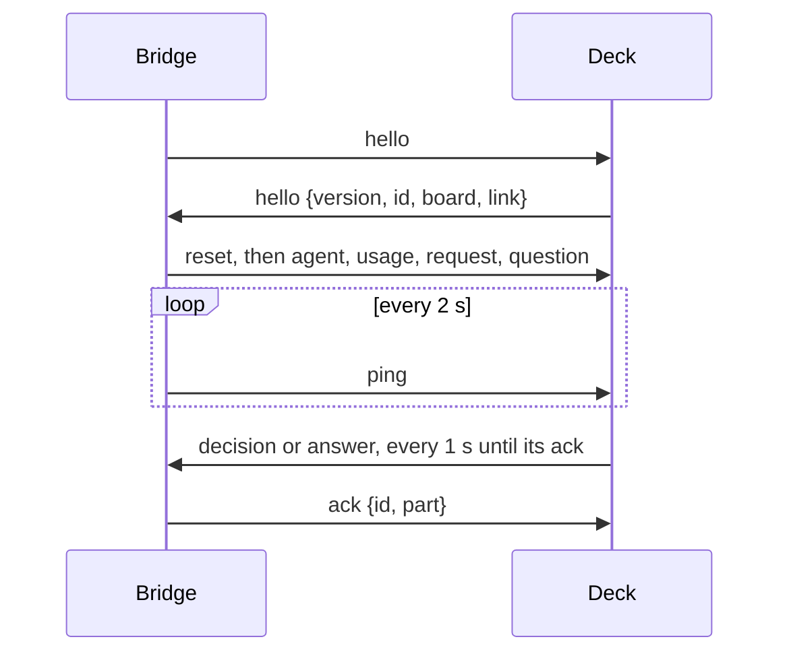

# Agent deck bridge — design

How the bridge works and why: what it reads from Claude Code, the records it makes, how it holds a permission request
or a question for the deck, how the plugin and `install.py` set it up, how the deck joins the Mac's Wi-Fi network,
the protocol both decks speak, and what is still open. For whoever changes the bridge; how
to install and use it is the [README](README.md).

**Source of truth.** The code in this folder, and this doc for the reasons. Claude Code's behaviour comes from its
documentation at code.claude.com `[CC]` and from real sessions recorded through the bridge `[R]`; where this doc and
Claude Code's documentation disagree, the documentation wins. The link between the bridge and a deck — its lines and
every record — is §10 here. Each deck's side — its screens, what each record shows, what it does with the link — is its
firmware repo's AGENT_DECK: the Nextion deck's
[docs/ONX2424G013_AGENT_DECK.md](https://github.com/alxv2016/nextion-agent-deck/blob/main/docs/ONX2424G013_AGENT_DECK.md)
and the round knob's
[docs/JC3636K718_AGENT_DECK.md](https://github.com/alxv2016/claude-agent-deck/blob/main/docs/JC3636K718_AGENT_DECK.md):
the records on the glass are their §6, the link's deck side their §16, and how Claude Code reaches the deck their §3.

**Stability.** The code cites this doc as `DESIGN.md §n`. Do not renumber; add new material under the next free
number.

| Tag | Meaning |
| --- | --- |
| `[CC]` | From Claude Code's documentation (code.claude.com/docs: hooks, status line, plugins, settings, sub-agents), read 2026-10-28 and 2026-10-29 |
| `[R]` | Seen in a real Claude Code session recorded through the bridge, with the date; Claude Code 2.1.195 on macOS unless stated |
| `[MAC]` | Seen on the developer's Mac, with the date; macOS 27 |
| `[?]` | Unverified; tracked in §8 |

| § | Section | Look here for |
| --- | --- | --- |
| 1 | [What it is](#1-what-it-is) | The bridge between Claude Code and the deck, in a picture |
| 2 | [Files](#2-files) | What each script does |
| 3 | [From Claude Code to the deck](#3-from-claude-code-to-the-deck) | Which hook or status line makes which record |
| 4 | [Permission requests](#4-permission-requests) | Holding a request for the deck, the stand-in, VS Code sessions, text on the glass, recordings |
| 5 | [Setting it up](#5-setting-it-up) | The plugin, `install.py`, using one or the other, the bridge stopping itself |
| 6 | [Decisions](#6-decisions) | Why command hooks, why a detached bridge |
| 7 | [Windows](#7-windows) | What runs there, what does not, the work |
| 8 | [Open items](#8-open-items) | What is not yet known or built |
| 9 | [Joining a network from the deck](#9-joining-a-network-from-the-deck) | The Wi-Fi records, the Keychain read, and where the password may go |
| 10 | [The link](#10-the-link) | The protocol both decks speak: the lines, every record each way, the exchange, the versions, the cable and Wi-Fi |

---

## 1. What it is

The bridge runs on the Mac beside Claude Code and turns its hooks and status lines into the deck's records, sent
over the USB-C cable; the deck sends back the developer's answer to a permission request or a question, which the bridge gives
Claude Code as the hook's response. Python 3.9 or later, the standard library only.

---

## 2. Files

| File | Does |
| --- | --- |
| `hook.py` | What Claude Code runs for every hook (`hook.py hook`), the `statusLine` (`hook.py status`) and the `subagentStatusLine` (`hook.py subagent-status`): POSTs the input to the bridge on `127.0.0.1:8737` (`DECK_BRIDGE_PORT` in Claude Code's environment), prints the bridge's answer, or the status line — `deck \| Opus \| ctx 8% \| 5h 23% \| 7d 41%`, `deck off` while the bridge is stopped. With the bridge stopped a hook prints nothing and exits 0. It waits for the bridge 2 s (`TIMEOUT_S`) inside each hook's 5 s `timeout` (`install.py`'s `HOOK_TIMEOUT_S`), and 590 s on a permission request, which the bridge may hold for the device. From the plugin, `hook.py hook --plugin`: it starts the bridge when none answers (§5) |
| `bridge.py` | The server, on `127.0.0.1` only, one at a time — a second finds the port taken and goes before it touches the deck: each input through the state machine, each record a JSON line on stdout; `--record FILE` keeps every input with its arrival time, the transcripts' included; `--port`, else `DECK_BRIDGE_PORT`, else 8737 — the same port `hook.py` posts to; `--context-window N`, the window a VS Code session's context share is taken of until a terminal session's status line has given its model's |
| `state.py` | The state machine (`Deck`): pure, the clock passed in, so a recording replays into the same records |
| `link.py` | What every link to the deck shares (§10): the `@deck <crc32> <json>` lines, framed and read, and `Link`, the one interface the bridge talks to — `kind` (`usb`, `wifi`), `grace_s`, `path`, `connected`, `start()`, `send()`, `release()`, each deck there, record and loss reported through `on_open`, `on_record` and `on_lost`. The cable's is `serial_link.py`, Wi-Fi's `net_link.py` |
| `serial_link.py` | The USB cable, a `Link` with no grace: the deck's port found and opened with DTR and RTS low, so the chip does not reset; its lines read on one thread, the board's log apart from the `@deck` frames; records written on another from a queue, so `send()` returns at once. A line the deck does not take in 1 s (`WRITE_WAIT_S`), or one past 256 waiting (`OUT_LINES`), is dropped and the port kept: the bridge sends under its lock, and a deck that stops reading — booting, hung, or a firmware that never reads the line — would otherwise hold every hook past `hook.py`'s 2 s. The queue is emptied as the port opens and closes; the deck's next hello brings everything again |
| `transcripts.py` | After each hook but `SessionEnd`, and each second while an agent works or a request is open, the session's transcript — its `isSidechain` lines skipped — and, for a hook with `agent_id` and `agent_type`, the sub-agent's (`agent_transcript_path`, else `<session_id>/subagents/agent-<agent_id>.jsonl` beside it) read on from where the last read stopped: the newest response's context, model and output tokens (`response_tokens`) and its `effort`, a response's lines carrying its final count, a new `ai-title`, the tool calls that ended, an interrupt no response came after, and a sub-agent's `description` from its `.meta.json`, once; each as a `transcript` input |
| `usage_cache.py` | Once a second, `~/.claude.json` parsed again if it changed, and only its `cachedUsageUtilization` kept: a new fetch's two windows as a `usage-cache` input in the status line's shape. `bridge.py --no-usage-cache` leaves the file unread |
| `usage_refresh.py` | While the deck is attached, `claude -p /usage --settings '{"disableAllHooks": true}' --no-session-persistence` as the deck connects and then hourly (`--refresh-usage`, 3600 s; 0 never) — the developer's choice, 2026-10-29: the shares move slowly, and each reset counts down from its moment between fetches — so the cache holds a fresh fetch: it fires no hooks — so no page of its own on the deck — keeps no session, and asks the model nothing. `--bare` would skip the login `/usage` needs `[R]` 2026-10-29 |
| `install.py` | Sets the bridge up: the hooks and both status lines in `~/.claude/settings.json`, backed up first, and on macOS, only when the developer says yes to its question — no the default, and the answer with no terminal to ask in — a login agent that runs `bridge.py --quiet` now and at every login and again if it stops, its log `~/Library/Logs/agent-deck-bridge.log`: the developer's choice, 2026-10-29, as starting at login unasked is invasive; `--login` and `--no-login` answer it, and no removes a login agent set up before; `--status` what is set up and whether the deck is attached (`GET /health`), `--uninstall` both out, `--dry-run`. It knows its own entries by their `hook.py` command wherever the folder lives, and stops at a status line that is not the bridge's; while its hooks are in, the plugin's stand aside (§5). The developer runs it — an agent's sandbox may not write `~/.claude` or `~/Library` |
| `replay.py`, `scrub.py` | Play a recording into records, or check them against a file — `--context-window N` as the bridge was run; clean a recording for the repo — ids, paths and free text replaced, the shape and timing kept |
| `test_bridge.py`, `fixtures/` | Every `<name>.inputs.jsonl` replayed into its `<name>.records.jsonl`, the rules one by one, the installer, `hook.py` through a running bridge, the plugin's state and its manifests |
| `wifi.py` | What the deck's Connect asks macOS (§9): the Wi-Fi device (`networksetup -listallhardwareports`), the networks the Mac has saved on it (`networksetup -listpreferredwirelessnetworks`), the deck's scan crossed with them, and one network's password (`security find-generic-password`), each command run as an argument list with its absolute path, never through a shell |
| `pairing.py` | Each deck's pairing for the link over Wi-Fi (§9): a login-Keychain item per deck — service `alxvlabs-agent-deck`, account the deck's `id` — holding the shared key the bridge made for it, its host, port and the SHA-256 of its certificate; written through `security -i` on stdin with its data as hex, so the key is never in a process's arguments, and read back with `find-generic-password -w`, the item being the bridge's own, so with no prompt; the paired decks' ids, nothing secret, in `~/Library/Application Support/alxvlabs-agent-deck/paired.json`, so the link over Wi-Fi knows whom to look for with no deck on the cable — a deck saying hello on the cable whose pairing the Keychain already holds is added |
| `net_link.py` | The link over Wi-Fi, a `Link` with a grace of 15 s (`GRACE_S`): the last deck paired found by its host, TLS with its certificate's SHA-256 compared with the one pinned (no CA trusted), the deck's challenge answered with the HMAC-SHA256 of its nonce under the shared key, then the `@deck` lines read and written on one thread, as an SSL socket is no place for two. A deck not there, or a session lost, is tried again every 5 s (`RETRY_S`). It stands down while a deck is on the cable: the cable wins; let loose by the cable going, it waits 2 s (`SETTLE_S`) first, as a cable plugged in can open, close and open again within about 100 ms. Its log says why each session ended |
| `plugin_state.py` | Whether the plugin is installed and switched on, from Claude Code's own files: `~/.claude/plugins/installed_plugins.json` and the `enabledPlugins` of each install's scope (§5) |
| `.claude-plugin/plugin.json`, `.claude-plugin/marketplace.json`, `hooks/hooks.json` | The plugin and the marketplace that lists it, both this folder (`"source": "./"`); every event of §3 running `hook.py hook --plugin` (§5) |

---

## 3. From Claude Code to the deck

| Input `[CC]` | Records |
| --- | --- |
| Any hook or status line from a session not yet seen | A session page, `done`, or `idle` and `active` false while another chat is active, named `Claude Code` until Claude Code titles the session: a hook's `session_title`, the status line's `session_name`, or the transcript's `ai-title`, the latest of them — the developer's choice, 2026-10-29, so two sessions in one folder read apart. A subagent status line or a `SessionEnd` from a session not yet seen makes none |
| `UserPromptSubmit` | Requests still open on its sub-agents closed, `answered_elsewhere`, and those sub-agents back to `working` — a deny in the terminal fires no hook; one with feedback arrives as this prompt, and the sub-agent works on until its own `SubagentStop` `[R]` 2026-10-29; the session's own open requests closed too, and the session `working`, detail `Thinking`, and its sub-agents that finished removed, one still running staying: the developer's choice, 2026-10-29, so the pages are the work in hand. The session is now the active chat, the closest there is to the one on view: no hook is known to fire as VS Code changes chat (§8). Every other agent gets `active` false, grey on the deck, the developer's choice, 2026-10-30; another session that was `done` goes `idle`, and its finished sub-agents are removed. What still runs keeps its state and page, and a request it makes opens on the deck |
| `UserPromptSubmit` for a prompt Claude Code submitted itself | The developer's prompts alone do all of the above. `prompt` starting `<task-notification>` changes nothing: a sub-agent that handed back gets one queued with no model call, so no `Stop` follows it, and a turn one does start shows from its first tool `[R]` 2026-10-31, Claude Code 2.1.314. `Another Claude session sent a message:`, a sub-agent's handback, starts a turn that ends in a `Stop`: the session `working`, detail `Thinking`, unless it still waits on a request of its own. Neither closes a request, takes the chat over or removes a finished sub-agent |
| `PreToolUse` | The agent's own open requests closed, `answered_elsewhere`; `working`, detail the tool and what it touches: `Bash: npm test`, `Edit: deck.cpp`, `WebFetch: example.com` |
| `PermissionRequest` for `AskUserQuestion` (`TERMINAL_ONLY`) | `needs_you`, detail `Question: …`, and with the deck taking questions a question record, one part of the call at a time, the terminal asking it meanwhile (§4); plain `allow` only lets the question be asked, seen on the board, the question still waiting in VS Code after the deck's Allow `[R]` 2026-10-29, so the deck's answer carries the answers. A question the deck cannot hold, over four options or with none, is left to the terminal |
| `PermissionRequest` | On the agent that asked — from inside a sub-agent it carries `agent_id` `[R]` 2026-10-29 — `needs_you`, then a request: the whole command and its description, the path and diff or new content, the URL and prompt, or else the input's fields one a line; over 2048 B of UTF-8 cut on a character and marked `cut` |
| `PostToolUse`, `PostToolUseFailure`, `PermissionDenied` | The agent's open request for that tool closed, `answered_elsewhere`; `working`. An allow in the terminal shows as the tool's `PostToolUse` `[R]` 2026-10-29, or `PostToolUseFailure` when it fails, each only once the tool has finished `[CC]` |
| `Notification` (`permission_prompt`, `elicitation_dialog`, `elicitation_url_dialog`, `agent_needs_input`) | The session `needs_you`, unless a request from it or its sub-agents is open: the notice carries no `agent_id` `[R]` 2026-10-29 |
| `Stop`, `SubagentStop` | `done`; open requests closed; a detail of `Thinking` cleared. In a previous chat, a session `idle` and a sub-agent removed. A session stops while a sub-agent it started works on, its `Agent` tool call already answered `[R]` 2026-10-29 |
| `SubagentStart`; a hook with `agent_id` | A sub-agent page under its session, `working`, named after `agent_type` until its transcript gives a description. A hook from an `agent_id` never started and with no `agent_type` makes none: Claude Code runs such an agent for itself about a second after each `Stop`, and it sends only its `SubagentStop` `[R]` 2026-10-29 |
| `SessionEnd` | Its sub-agents removed, then the session; the active chat's leaves none active until a chat is prompted or opened |
| Once a second | A previous chat working with no hook for `STALE_S`, 600 s, `idle`, or removed for a sub-agent: an interrupt sends no `Stop`, and a previous chat has no next prompt to clear it |
| An interrupt in the transcript `[R]` 2026-10-31 | As a `Stop` or `SubagentStop`, which neither a refusal in the terminal nor Esc fires: the agent's open requests closed, and `done`, or `idle` or removed in a previous chat. Claude Code writes `[Request interrupted by user]`, or `… for tool use]`, as a user line; 37 of them in real sessions, none followed directly by a response, and a sub-agent's ends it, its task `killed`. The bridge reads on each second while an agent works; one older than the agent's turn, or with a response after it, is history |
| The deck's `hello` | What the bridge sends from then on (§10.5): from `version` 3 the state `idle` and `active`; an older deck gets `done` and no `active` (`shows_idle`), as it would read `idle` as `Working` and never make room for another agent. From `version` 4 the deck's names (§10.3) are logged as they change and given by `GET /health` and `install.py --status`. The Nextion deck's `version` 3 hello, with none of them, keeps everything it has |
| Status line | The session's `context_pct`, and the window for its model; usage, sent again as a reset's minutes change, and a window past its `resets_at` unknown — its share was the old window's, as Claude Code drops it then `[CC]` |
| Usage cache `[R]` 2026-10-29 | Usage, when its fetch is newer than the last status line's arrival — the newer of the two always wins |
| Subagent status line | Nothing: the VS Code extension runs none, and the transcript gives every session and sub-agent the same figure |
| Transcript `[R]` 2026-10-30 | An agent's `tokens`, as Claude Code's agent map counts them: a session's context, a sub-agent's context with its last response's output, 85,457 + 3,287 for a map's `88.7k tokens`. A response's line carries its final count, written as it ends, and the bridge reads on at each hook, so the figure follows by a tool call. An agent's `model`, shown while it is not working or has no tokens yet: its model as Claude Code names it, `Opus 5.5` from `claude-opus-5-5`, the older and cloud providers' spellings read too and an id it does not recognise sent as it came, and its effort, `Opus 5.5 • high`, from a hook's `effort.level` `[CC]` or the transcript line's `effort`; a sub-agent's page named after its `description`, as Claude Code's agent map titles it; a session named after its `ai-title`; a session's `context_pct` while no status line has given one, its window from a status line for its model, `--context-window`, or `KNOWN_WINDOWS` (`claude-opus-5-5` 1M, from the developer's session at 664k tokens with 31 % left before auto-compact) |

---

## 4. Permission requests

- **A request is held for the deck's answer with `--hold SECONDS`** (570 by default, under 580): its hook's HTTP
  request waits for the answer — `allow`, or `deny` with the message `Denied on the agent deck.` — up to the
  hold, then goes back with no decision and the request closes `timed_out`. A request answered in the terminal
  lets its hook go at once with none, so a late answer from the deck reaches nothing. `hook.py` waits 590 s on a
  permission request (`REQUEST_TIMEOUT_S`) inside its hook's 600 s `timeout` (`install.py`, `hooks/hooks.json`). With no deck attached
  and no `--answer`, every request goes back at once with no decision (§10.4).
- **No hook says the terminal answered** `[CC]`: an allow shows only when its tool ends, and a manual deny fires
  nothing, `PermissionDenied` being auto mode's and `Stop` not running on an interrupt. So the bridge looks in two more
  places while a request is open. Each second it reads on in the transcript for a `tool_result` of the call it holds,
  by the `tool_use_id` of its `PreToolUse`, which a refused call should have at once `[?]` (§8); the format is
  undocumented, as transcripts are. Every 250 ms (`GONE_POLL_S`) it looks at the hook's connection, which closes if
  Claude Code stops the hook; whether it does is undocumented (§8). Either closes the request `answered_elsewhere`.
  An allow whose tool runs for minutes, if Claude Code leaves the hook running, still shows until the tool ends.
- **A question is held at its `PermissionRequest`, as a request is**, so the terminal asks it meanwhile and whichever
  is answered first settles it — the developer's ask, 2026-11-05: held at `PreToolUse` it showed nothing in the terminal
  until the hook went back. The deck's answer goes back as `allow` with `updatedInput`, the input's `questions` and an
  `answers` map, as the Agent SDK's `canUseTool` answers a question `[CC]`; from a hook that is undocumented `[?]` (§8).
  `answers` is keyed by each question's text, its value the option's `label`, several joined with `, ` `[CC]`. An
  answer in the terminal ends the call, and its `PostToolUse` or its `tool_result` closes the question
  `answered_elsewhere`. It is held `--hold` seconds, all its parts together, then closes `timed_out`, the terminal still
  asking. `PreToolUse` holds nothing: its hook's `timeout` is 5 s again.
- **Losing the deck lets what is held go**, at once on the cable: a pulled cable means the developer has gone to the
  terminal. A link with a grace (`Link.grace_s`, about 15 s on Wi-Fi) keeps every held request and question that long
  first, and a deck whose hello comes within it gets them again in the snapshot — a hello read after its link closed
  counts for nothing; a hold begun during the grace keeps its own end, and every hold's end still counts
  (§10.6).
- **The deck says it takes questions**: `hello` with `version` 2 or later turns them on (`asks_questions`), and losing
  the deck — past any grace — turns them off. A deck on older firmware never gets a record it would drop while its hook waits; it keeps
  `needs_you` and the terminal.
- **One record to a part.** The link drops JSON nested past two levels (§10.1), and a call holds up to four questions of
  objects, so each goes as a flat `question` record, the next once the last is answered, under one `id` with its
  `part`. The deck answers `{"id", "part", "chosen"}`, bit n for option n, and the `ack` gives the `part` back; a
  resend of an earlier part changes nothing. `chosen` 0 leaves the whole call to the terminal: the hold on the question (KEY on the Nextion deck, BOOT on the knob), or the deck's queue full.
- **An option's card is `label: description`**, 400 characters, the question 400 too, both shown whole on the glass (the deck's kOptionChars, kQuestionChars; the developer's ask, 2026-11-05); what goes back
  is always the `label`. "Other" and free text are the terminal's.
- **`--answer allow|deny SECONDS` stands in for the device**, answering each held request so long after it
  opens — the answers tried with no deck attached. It leaves questions alone: their answer is the developer's.
- **A session in the VS Code extension runs no status line.** It runs neither the status line nor the subagent status line `[R]`
  2026-10-29: its hooks give the pages, states, details and requests, Claude Code's usage cache the usage, which the extension does not write but the bridge's `claude -p /usage` does as the deck
  connects and hourly after, and a terminal session's status line brings with every response — its
  transcripts each agent's tokens, the session's title and sub-agent names, and its context share once its model's window is known — from a
  terminal session's status line for that model, `--context-window`, or `KNOWN_WINDOWS`; the transcript names the model without the window (`claude-opus-4-8`, where the
  status line says `claude-opus-4-8[1m]`) `[R]` 2026-10-29. `claude -p "/usage"` prints nothing `[R]` 2026-10-29;
  the plan's limits reach the bridge from a status line or the usage cache only.
- **Text reaches the records as the glass draws it** — ASCII, `°` and `•`, every other character `?`; names
  40, details 64, a model and effort 24 and tools 48 characters, cut with `...`.
- **An agent record goes out only when something but `since_s` changed** — the device counts `since_s` up
  itself ([AGENT_DECK §6](https://github.com/alxv2016/nextion-agent-deck/blob/main/docs/ONX2424G013_AGENT_DECK.md#6-data-the-screens-take)).
- **A recording holds prompts, commands and file contents.** It stays in `$TMPDIR`, outside the repo; only its
  `scrub.py` output, read first, goes in `fixtures/`, beside the records `replay.py` makes of it.

---

## 5. Setting it up

Two ways, one or the other: the Claude Code plugin, which carries the hooks and starts the bridge itself, or
`install.py`, which writes the hooks into the developer's settings and may start the bridge at login. Both run the
same `hook.py` and `bridge.py`.

| | The plugin (`alxvlabs-agent-deck`) | `install.py` |
| --- | --- | --- |
| Installed with | `/plugin marketplace add alxv2016/alxvlabs-agent-bridge`, then `/plugin install alxvlabs-agent-deck@alxvlabs` | `python3 install.py` in a copy of this folder |
| The hooks | `hooks/hooks.json`, run from `${CLAUDE_PLUGIN_ROOT}`, merged with the developer's own `[CC]` | Written into `~/.claude/settings.json`, backed up first |
| The bridge | Started detached by the first hook that finds none answering, and running on across sessions | Run by hand, or by the login agent if the developer says yes |
| The status line | None — a plugin cannot set one: only `agent` and `subagentStatusLine` take effect from a plugin's settings `[CC]`. Nothing depends on it: the usage refresh and the transcripts give what it gave | `deck \| …` or `deck off` |
| Stopped by | Disabling or uninstalling the plugin: the bridge sees it and goes | `install.py --uninstall`, or Ctrl-C |
| Updates | `/plugin update`, when `version` in `.claude-plugin/plugin.json` changes; auto-update is off for a marketplace that is not official unless turned on `[CC]` | A new copy of the folder, then `install.py` again |

- **The plugin's hooks stand aside while `install.py`'s are in the user settings**, so no event reaches the bridge
  twice: `hook.py hook --plugin` exits at once when it finds `install.py`'s `hook.py` commands there. `install.py`
  and `install.py --status` say when the plugin is installed too.
- **A hook from the plugin starts the bridge when none answers** — any hook, not only `SessionStart`, since a plugin
  installed mid-session runs its hooks in that session `[R]` 2026-10-29. It starts `bridge.py --quiet --plugin
  alxvlabs-agent-deck` in its own session with no terminal, its log `~/Library/Logs/agent-deck-bridge.log`
  (`~/.local/state/` off macOS), then waits up to 2 s (`START_WAIT_S`) for it to listen and gives it the input
  that started it. Two hooks starting one each at once is harmless: the second bridge finds the port taken and goes.
- **Claude Code stops nothing the plugin started** `[R]` 2026-10-29: a probe plugin's `SessionStart` hook started one
  detached Python process, which ran on after `/exit`, after `claude plugin disable` and after `claude plugin
  uninstall`. So the bridge stops itself: every 10 s (`PLUGIN_CHECK_S`) it asks `plugin_state.py`, and goes once the
  plugin it has seen installed is uninstalled or disabled, or its own folder is gone.
- **An update replaces a running bridge.** Claude Code keeps the old version's folder, marked `.orphaned_at`, beside
  the new one `[R]` 2026-10-30, so a folder still there says nothing: the bridge goes once `installed_plugins.json`
  no longer lists its folder, having listed it, or its folder carries the mark. It waits for any request it holds, so
  no answer is cut off, then lets go of the port and the cable and starts the listed version's `bridge.py` itself
  (`successor()`), so the deck is back within about `PLUGIN_CHECK_S` (10 s) of the update — the developer's ask,
  2026-11-05: waiting for the next hook left the deck with no bridge until a session did something. A plugin disabled
  or uninstalled starts nothing. A hook starts the listed version's `bridge.py`, not
  its own folder's, as a session opened before the update still runs the old `hook.py`. A folder never listed and
  never marked is `claude --plugin-dir`'s, and stays. Versions before 0.2.1 do none of this, so leaving one takes a
  manual `kill`, as the README says.
- **Disabled means every install's settings say false.** An install's scope picks its settings file — `user`
  `~/.claude/settings.json`, `project` the project's `.claude/settings.json`, `local` its
  `.claude/settings.local.json` — and the plugin is off only when every install's file has
  `enabledPlugins["alxvlabs-agent-deck@<marketplace>"]` false. A file missing, caught mid-write or holding no switch
  counts as on: a wrong stop loses the deck, a late one only leaves the bridge idle.
- **A bridge run from a folder Claude Code was pointed at** (`claude --plugin-dir`) is never listed as installed,
  so it is never seen uninstalled and runs until stopped by hand.
- **Nothing is kept in the plugin's data folder** (`${CLAUDE_PLUGIN_DATA}`): an uninstall deletes it `[R]`
  2026-10-29, under a bridge that may still be running.
- **The plugin and the marketplace are this one folder**: `.claude-plugin/marketplace.json` lists the plugin with
  `"source": "./"`, so the repo root is both. A plugin's name may not start with `claude-` `[CC]`; the marketplace is
  `alxvlabs`.

---

## 6. Decisions

| Decision | Why | Alternatives that don't work, and why |
| --- | --- | --- |
| Every hook a command hook through `hook.py` | With the bridge stopped, Claude Code runs as without it: no notice, its own prompt (§4) — the developer's choice, 2026-10-29 | `type: "http"` hooks — a `hook error` notice on every event while the bridge is stopped `[CC]`, and `SessionStart` and the status line take only commands `[CC]` |
| From the plugin, a detached bridge that stops itself | One process holds the deck's port across every session, started with no setup step | An MCP server or a monitor — each runs per session and stops with it `[CC]`; a login agent — no plugin component starts one |
| Starting at login asked, no the default (`install.py`) | Starting a background process at every login unasked is invasive — the developer's choice, 2026-10-29 | Always on — a process the developer never chose; never — the deck goes blank after every restart |

---

## 7. Windows

Claude Code and the deck both work on Windows — the deck appears as a COM port through Windows' own USB serial
driver — but the bridge does not yet. Until it does, the plugin's hooks never start the bridge on Windows
(`hook.py`'s `can_start()`): a bridge that fails as it starts would make every hook wait its 2 s for it.

| Part | On Windows |
| --- | --- |
| `hook.py`, `state.py`, `transcripts.py`, `usage_cache.py`, `usage_refresh.py`, `plugin_state.py` | Expected to run as they are: the standard library's networking, `~` as `%USERPROFILE%`, `claude` found on `PATH` |
| `serial_link.py` | Does not: it uses `termios` and `fcntl`, Unix only, and looks for `/dev/cu.usbmodem*`, `/dev/cu.wchusbserial*` and `/dev/ttyACM*`; `bridge.py` imports it, so the bridge does not start |
| The hooks | Quoted for a Unix shell, and `python3`; Claude Code on Windows runs a command hook through Git Bash when installed, else PowerShell, and an exec-form hook (`command` with `args`) needs a real `.exe`, such as `python.exe` `[CC]` |
| `install.py`, starting at login | macOS only; the Windows counterpart is a Task Scheduler task at log on running `pythonw.exe`, which opens no console window — behind the same question |

- **The work:** a Windows back end for `serial_link.py` — the standard library's `ctypes` over Windows' serial API,
  keeping "nothing to install", or the `pyserial` package at the cost of one install step — opening the COM port with
  DTR and RTS held low so the deck does not reset (either firmware's FIRMWARE_CONFIG §8); finding the deck's COM port,
  or `--serial COM5`; the hooks in exec form; the login task.
- **What it needs:** a Windows PC with the deck attached to test on — the serial behaviour cannot be checked from
  macOS.

---

## 8. Open items

| Item | Status | Unblocked by |
| --- | --- | --- |
| Which chat is on view: that no hook fires as VS Code changes chat, and when `SessionEnd` fires for a chat left open, neither of which Claude Code documents. The active chat is the one last prompted until then | Open `[?]` | A real session logging its hooks through a change of chat, a new chat and a closed tab |
| The bridge on Windows (§7): the deck as a COM port, the hooks through Git Bash or PowerShell, the login task | Open `[?]` | The Windows serial back end, run on a Windows PC with the deck attached |
| A sub-agent's silent `<task-notification>` on Claude Code 2.1.314: `UserPromptSubmit` with that prompt is recorded on 2.1.195 and read from 2.1.314's code, not yet recorded on it | Open `[?]` | One run with `--record` and a background sub-agent |
| A request answered in the terminal, in a real session: that a deny's `tool_result` reaches the transcript at once, and whether Claude Code stops the held hook, which decides how fast an allow leaves the deck | Open `[?]` | One allow and one deny in the terminal, with a long-running tool |
| A question answered on the deck in a real session: Claude Code taking `answers` in `updatedInput` from a `PermissionRequest` hook's `allow`, with a multi-select's labels joined, its terminal prompt going as the deck answers; and what pressing Esc on that prompt leaves behind | Open `[?]` | One real `AskUserQuestion` with the deck attached |
| The plugin end to end: installed from the GitHub marketplace, the bridge started by a hook, stopped by a disable and by an uninstall | Open `[?]` | One install from `alxv2016/alxvlabs-agent-bridge` with the deck attached |

---

## 9. Joining a network from the deck

The deck's Wi-Fi page asks the bridge, on the cable, for the network the Mac is on and its password, so it can join
the same one; macOS's own admin prompt guards the password. The flow and the deck's side are the knob's
[AGENT_DECK §19.8](https://github.com/alxv2016/claude-agent-deck/blob/main/docs/JC3636K718_AGENT_DECK.md#198-joining-a-network-from-the-deck).
`wifi.py` asks macOS; `Bridge.wifi_join()` and `wifi_pick()` answer the deck.

| Record | From | Carries |
| --- | --- | --- |
| `wifi_join` | Deck | `names`, `rssi`, `secure`: its 2.4 GHz scan, at most 10 networks (`MAX_SCAN`), each once, strongest first |
| `wifi_choose` | Bridge | `names`, `rssi`: the scanned networks the Mac has saved, when there are several, in the deck's order with its signals |
| `wifi_pick` | Deck | `name`: the one picked with the knob |
| `wifi` | Bridge | `name`, `password`, `key`: the network to join, `""` for an open one, `secure` false in the scan; and the pairing's shared key, 64 hex digits, new with every network sent |
| `wifi_paired` | Bridge | No fields: the pairing kept in the Keychain, after a `wifi_status`; the deck's page leaves its bridge step |
| `wifi_status` | Deck | `id`, `host`, `address`, `port`, `fingerprint`: where a paired deck serving TLS is, and its certificate's SHA-256 to pin; kept in the Keychain only after a key was sent |
| `wifi_error` | Bridge | `reason`: `not_in_reach` — no scanned network saved on the Mac, or a pick never offered; `cancelled` — the admin prompt cancelled, refused or left 120 s; `no_password` — no Keychain item, or any other failure |

- **The Mac's network is found by elimination.** macOS hides the current network's name from a process with no
  Location permission; the networks it has saved are listed to anyone `[MAC]` 2026-11-03. The scan crossed with that
  list leaves the candidates: one is taken, several go to the deck as `wifi_choose`, none is `not_in_reach`. A pick
  must name a network the last `wifi_join` offered.
- **The password comes from the Keychain**, `security find-generic-password -D "AirPort network password" -a <name>
  -w`, the name an argument of its own. macOS asks for the admin password first `[MAC]` 2026-11-03, so the lookup
  waits up to 120 s (`KEYCHAIN_TIMEOUT_S`) on a thread of its own: the serial reader and the hooks never wait on the
  prompt, and a second `wifi_join` while it runs is ignored. An open network reads nothing.
- **`security` exits with the OSStatus' low byte**, as `security error` names them: 44 is errSecItemNotFound
  (−25300), `no_password`; 128 errSecUserCanceled (−128), 51 errSecAuthFailed (−25293), 36
  errSecInteractionNotAllowed (−25308), 154 and 155 Authorization Services' cancelled and denied, all `cancelled`.
  The plugin's bridge, started detached by a hook, brings up the prompt and reads the password, and a prompt
  cancelled ends as `cancelled` on the deck `[MAC]` 2026-11-03; which of those codes the cancel gave was not logged,
  and a wrong admin password, falling in the same set, ends the same way.
- **Only the cable's word reads the Keychain.** The bridge takes `wifi_join` and `wifi_pick` only when the link that
  carried them — each link's records reach it with the link (`Bridge.attach()`) — has `kind` `usb`, and drops them
  from any other, so nothing on the network can make the bridge read a password.
- **Every network sent goes with a new shared key**, 32 random bytes in hex (`key` in the `wifi` record), held in
  memory until the deck answers or is lost. Joined and serving TLS, the deck sends `wifi_status` on the cable — its
  `id`, `host` (`agentdeck-<id>.local`), `address`, `port` (8443) and `fingerprint`, the SHA-256 of its certificate —
  and the bridge keeps the pairing in the Keychain (`pairing.py`): only from a `usb` link, only after a key was sent,
  and only for the deck whose hello named that `id`. Its log says `paired with the deck <id> at <host>:<port>,
  certificate <16 hex>…`, never the key. A `wifi_status` with no key sent — a deck rejoining a network it kept — pairs
  nothing.
- **The deck is reached over Wi-Fi once paired** (`net_link.py`): with no deck on the cable the link looks for the last
  deck paired and, the session answered, becomes the bridge's link — records, pings and acks go on it, and a hello
  over it says `link: "wifi"`. A deck opening on the cable makes the cable the bridge's link and stands the Wi-Fi link
  down; losing the cable lets it look again once the cable has stayed gone 2 s (`SETTLE_S`). A link the deck was not on going lets nothing held go. While the cable is
  open the Wi-Fi link neither connects nor, connecting as the cable opens, takes over; the link in use lost with another
  still open falls back to it, the deck asked to say hello there; and a hello on the cable makes it the link. Losing the cable
  with a deck paired for Wi-Fi waits the Wi-Fi link's grace (`GRACE_S`, 15 s) before letting what is held go, so a deck
  unplugged to leave the desk gets them back over Wi-Fi in the snapshot. Nothing that
  reaches the bridge over Wi-Fi can make it read the Keychain: `wifi_join`, `wifi_pick` and `wifi_status` are taken
  from the cable alone.
- **The password is held in memory only, and goes on the cable alone.** The `wifi` record is sent straight to the
  link, not through `emit()`: never on stdout, which is the plugin's log, never in `--record`'s file, which keeps only
  Claude Code's inputs, and so never in `replay.py`'s or `scrub.py`'s. Nothing about a lookup is logged but a failure's
  kind. The neighbours' network names stay out of the log too: a damaged Wi-Fi frame reaches the board's log cut at
  its prefix (`serial_link.log_text()`). The tests use made-up networks and passwords only.

---

## 10. The link

The one home of the protocol between the bridge and its decks: the Nextion deck (ONX2424G013,
[nextion-agent-deck](https://github.com/alxv2016/nextion-agent-deck)) and the round knob (JC3636K718,
[claude-agent-deck](https://github.com/alxv2016/claude-agent-deck)). Each firmware's AGENT_DECK §16 says what its deck
does with these lines, and its §6 what a record shows on the glass; the code here is `link.py` (the lines),
`serial_link.py` and `net_link.py` (the links), `state.py` (the records) and `bridge.py` (the exchange).

### 10.1 Lines

- **Every line is `@deck <crc32> <json>`**, both ways, on every link: the prefix, the CRC-32 of the JSON's bytes in eight
  lowercase hex digits (IEEE 802.3, as Python's `zlib.crc32`), a space, one JSON object, a newline (`link.encode()`).
  So the records and the state machine never learn which link carried one.
- **A line whose CRC fails, or whose JSON is not one object, is dropped** (`link.decode()`); the decks drop one nesting
  deeper than two levels too — an object of plain values and arrays of plain values is all a record may hold, so a
  question goes one part at a time (§4).
- **The prefix may sit anywhere in a line.** On the cable the board's console log shares the stream, and a log line
  split by a write can carry a frame at its end; what is not a frame is the board's log (`serial_link.py`).
- **A line is at most 8 KB** — what both decks read (their `kMaxLine`); a request's body is cut to 2048 B to stay
  well inside it (§3).
- **Text is what the glass draws** — ASCII, `°` and `•`, every other character `?` (`to_glass()`, §4).

### 10.2 From the bridge

| Record | Fields | Does |
| --- | --- | --- |
| `hello` | — | Asks the deck for its hello, as a link opens and when the link in use changes (§10.4) |
| `reset` | — | Everything on the deck forgotten; the snapshot follows: sessions, sub-agents, the usage, open requests and questions |
| `agent` | `id`, `parent` (0 for a session), `name` (40 characters), `state` (`working`, `needs_you`, `done`, `idle`), `since_s`, `detail` (64), `context_pct`, `tokens`, `model` (24), and `active` false for an agent of a previous chat | A page added or changed — sent only when something but `since_s` changed, the deck counting it up itself (§4). `idle` and `active` go only to a deck of `version` 3 or later; an older one gets `done` |
| `remove` | `id` | A page gone |
| `usage` | `five_hour_pct`, `five_hour_resets_min`, `seven_day_pct`, `seven_day_resets_min`, each −1 unknown | The plan's two windows (§3) |
| `request` | `id`, `agent`, `tool` (48), `body` (2048 B of UTF-8), `cut` | A permission request held for the deck (§4) |
| `question` | `id`, `agent`, `part`, `tool`, `question` (400), `options` (1 to 4 strings, 400 each), `multi` | One part of an `AskUserQuestion`, all parts under one `id` — only to a deck of `version` 2 or later (§4). The knob shows 400 whole; the Nextion deck cuts a question to 240 and an option to 96 (its AGENT_DECK §6) |
| `close` | `id`, `reason` (`answered_elsewhere`, `timed_out`) | A request or question settled elsewhere, or past its hold |
| `ack` | `id`, and `part` for a question's | An answer reached the bridge, so the deck stops sending it |
| `ping` | — | Every 2 s (`PING_S`) while a deck is there |
| `wifi_choose`, `wifi`, `wifi_paired`, `wifi_error` | §9 | The Wi-Fi join, on the cable only |

### 10.3 From the deck

| Record | Fields | Does |
| --- | --- | --- |
| `hello` | `version`, and from 4 `id`, `board`, `link` | What the deck takes (§10.5) and, from 4, which deck it is: `id` its Wi-Fi MAC's last two bytes in hex, `board` (`jc3636k718`), `link` (`usb`, `wifi`, or `mock` inside the firmware) — each 1 to 16 of `a`–`z`, `0`–`9` and `-`, so the line needs no escaping; a name breaking that names nothing, its version still counting. The bridge answers it with the snapshot |
| `decision` | `id`, `allow` | The answer to a request |
| `answer` | `id`, `part`, `chosen` | The answer to a question's part: bit n for option n, several for a `multi`, 0 to leave the whole call to the terminal (§4) |
| `wifi_join`, `wifi_pick`, `wifi_status` | §9 | The Wi-Fi join and pairing, taken from the cable only |

### 10.4 The exchange

- **A hello starts everything.** The bridge sends its own as a link opens; a deck still booting misses it, and its own
  hello at start answers instead. A deck's hello, at start, after losing the bridge, or asked, brings the snapshot —
  only then, once the deck listens. A boot hello crossing the bridge's can bring two snapshots: the second closes a
  request on view and opens it again, nothing lost.
- **The deck takes the bridge for gone after three pings missed** (`kLostMs`, 6 s on both decks): it forgets
  everything and waits for the bridge's hello, saying hello itself.
- **The deck sends each answer again every second until its `ack`, ten times at most** (`kResendMs`, `kMaxSends` on both
  decks). A resend of an answer already taken changes nothing; an answer for a request the bridge let go reaches
  nothing (§4).
- **A request the deck never answered goes back to the terminal** — past the hold, or the deck lost past the link's
  grace — and closes `timed_out`; no snapshot carries it again (§4).

### 10.5 Versions

| `version` | The deck takes | Decks |
| --- | --- | --- |
| 1 | `agent` (no `idle`, no `active`), `remove`, `usage`, `request`, `close` | — |
| 2 | `question` too | — |
| 3 | `idle` and `active` too | The Nextion deck |
| 4 | Names itself in its hello (`id`, `board`, `link`), and the Wi-Fi join and link (§9, §10.6) | The round knob |

The bridge sets what it sends from the last hello (`Deck.asks_questions`, `Deck.shows_idle`), so an older deck never
gets a record it would drop while a hook waits on it.

### 10.6 Links

| | The cable (`serial_link.py`) | Wi-Fi (`net_link.py`) |
| --- | --- | --- |
| `kind` | `usb` | `wifi` |
| Reached by | The deck's port — the one `/dev/cu.usbmodem*` (the ESP32-S3's USB Serial/JTAG), `/dev/cu.wchusbserial*` (a CH340 USB-UART, the ONX3248G035's) or `/dev/ttyACM*`, else `--serial` — opened with DTR and RTS held low so the chip does not reset | The last deck paired (§9): `agentdeck-<id>.local` (mDNS, `_agentdeck._tcp`), port 8443 |
| Trust | The cable | TLS with the deck's certificate pinned by its SHA-256, no CA trusted; then the deck's `agentdeck-challenge <nonce>` — 32 random bytes in lowercase hex — answered within 5 s (the knob's `kAuthMs`; `AUTH_S` 10 s here) with `agentdeck-answer <HMAC-SHA256 of the nonce under the shared key>`, and its `agentdeck-ok` before any `@deck` line |
| Grace (`grace_s`) | 0 s: a pulled cable means the developer has gone to the terminal, so what is held goes at once | 15 s (`GRACE_S`): a deck back within it gets what is held again in the snapshot — the link comes back 5–10 s after the deck's Wi-Fi does (the knob's AGENT_DECK §19.4) |
| Carries | Every record, the Wi-Fi join's and pairing's included | Every record but the Wi-Fi join's and pairing's (§9) |

- **One deck at a time.** The bridge holds one deck's capabilities, from the last hello, and one link, so a deck on
  both links counts once: the cable wins, and the Wi-Fi link reaches only the deck paired by its `id` (its host
  `agentdeck-<id>.local`, §9). The bridge does not compare ids across links.
- **The cable wins**, on both sides: while a deck is on the cable the Wi-Fi link stands down, and while the bridge speaks
  on the cable the deck talks there; let loose by the cable, the Wi-Fi link waits 2 s (`SETTLE_S`) first (§9).
- **The hooks stay on `127.0.0.1`.** Nothing on the network reaches the bridge but the deck's session it opened itself.
